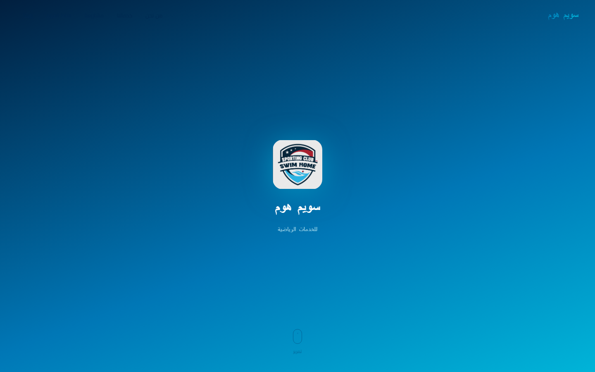
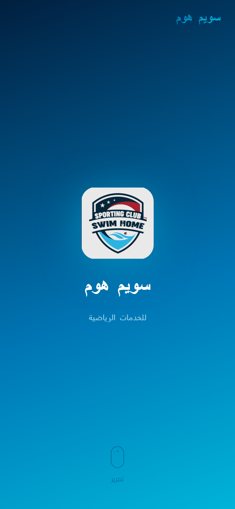

# Swim Home Sports Services Website

An Arabic, right-to-left website for Swim Home Sports Services in Egypt. The landing page introduces the company and its work in swimming pool construction, facility operations, training programs, staffing, marketing, quality, and sports events.

**Live site:** https://ahmed-hebila.github.io/swim-home-portfolio/

| Desktop | Mobile |
| --- | --- |
|  |  |

## Website sections

- Company overview and service areas
- Services offered
- Project timeline and selected work
- Strengths and company vision

## Built with

- HTML, CSS, and JavaScript
- GSAP and ScrollTrigger for motion effects
- Cairo, Inter, and Montserrat fonts

## Project structure

- `index.html` — Arabic landing page
- `css/` — theme, layout, components, and visual effects
- `js/` — page interactions
- `assets/images/` — website images and logo

## View locally

Open `index.html` in a browser. Google Fonts and GSAP are loaded from external CDNs, so an internet connection is needed for those assets.

The site is published with GitHub Pages.

## Author

**Ahmed Hebila** — Flutter & Node.js developer
[Portfolio](https://ahmedhebila.vercel.app) · [LinkedIn](https://www.linkedin.com/in/ahmed-hebila) · [GitHub](https://github.com/Ahmed-hebila)
